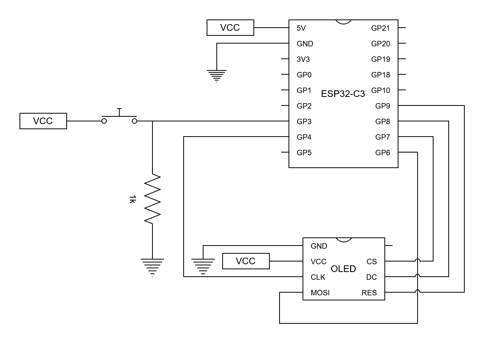

# OLED Gauge
Displays data from an ELM327 based Bluetooth ODBII reader on a 128x64 OLD display, running on an ESP32.

## Hardware
### Components
 - ESP32-C3 Mini ([example](https://core-electronics.com.au/esp32-c3-mini-dev-board-risc-v-processor-wi-fi-bt5-smd-compatible.html))
 - 128x32 Monochrome OLED display with SPI ([example](https://www.jaycar.com.au/duinotech-arduino-compatible-1-3-inch-monochrome-oled-display/p/XC3728))
  - ELM327 Bluetooth OBDII adapter

### Wiring Diagram

Note pin numbering goes from 1-18, starting with the 5V pin as pin 1.

## State of Work
### Software
 - [x] Print data with heading to OLED display over SPI (number of button presses)
 - [x] Run as BLE server to manually set value to display on OLED
 - [ ] Run as BLE client to connect to ELM327
 - [ ] Display data from ELM327

### Hardware
 - [x] OLED display connected
 - [ ] Vehicle power supply sorted (likely LM7805)
 - [ ] Enclosure and mounting

### Potential later features
 - Second MCU for adding sensors
   - Communicate over CAN
 - Second display
   - Daisy chain either just power or comms over CAN